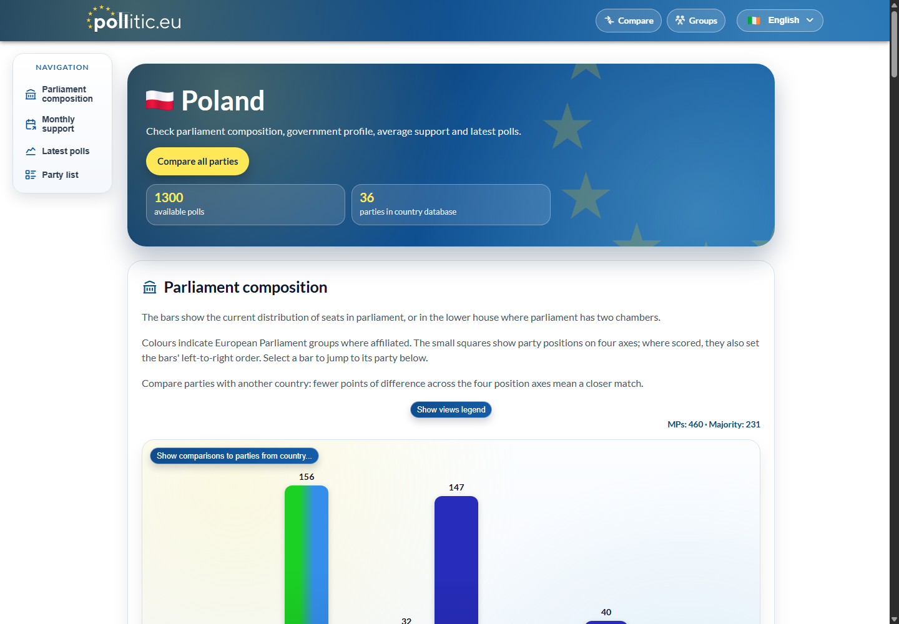
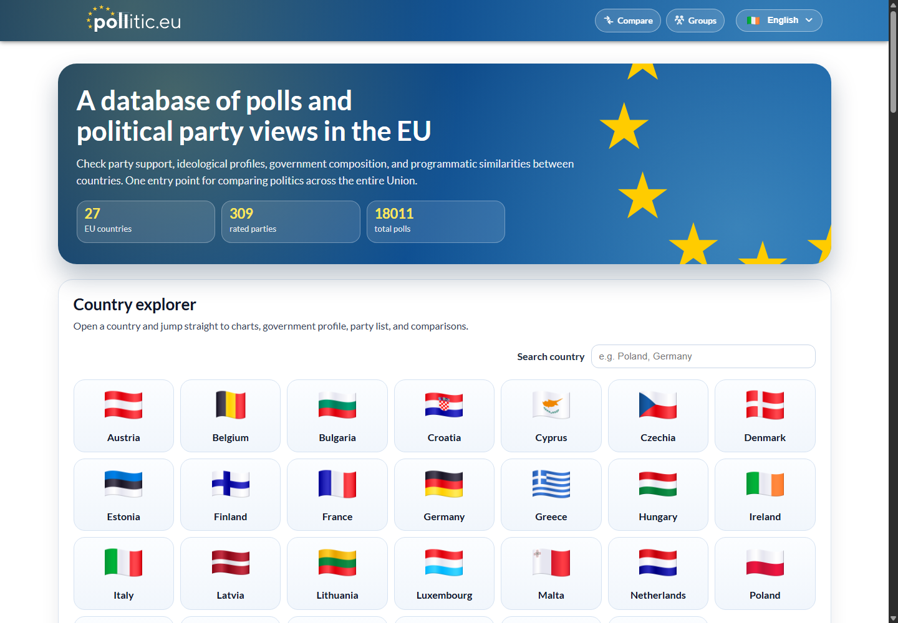

# Pollitic.EU

A multilingual full-stack web application for exploring European political polls, political parties, ideological profiles and parliamentary scenarios.

**[Live application](https://pollitic.eu/en)** · **[Selected source code](source-snapshot)**

Developed and operated by **Eryk Wybranowski**. This repository presents selected complete, unchanged files from the application - about 15% of the total code. The full production repository remains private.

## Technologies

- **Frontend:** Angular 18, TypeScript, RxJS, Chart.js, Angular SSR and Express.
- **Backend:** ASP.NET Core / .NET 9, Entity Framework Core, MySQL.
- **Automation:** background workers, social-platform API integrations and Playwright image rendering.
- **Infrastructure:** Docker, Docker Compose, Nginx, Traefik, GitHub Actions and a Linux VPS.
- **Quality:** backend tests, Angular/Jasmine tests, Cypress and Node.js checks.

This stack describes the full application; the public snapshot includes selected parts of it.

## Features

- Polling data and interactive visualizations for EU countries.
- Political-party comparisons and parliamentary-seat scenarios.
- 24 language versions with localized URLs, server-rendered public pages and SEO metadata.
- Automated data updates and social-media publication workflows.
- Containerized deployment and ongoing operation of the live service.

## Code highlights

| Area | Original files |
| --- | --- |
| Interactive Angular charts | [Component](source-snapshot/frontend/src/app/polling-graph/polling-graph.component.ts), [HTML](source-snapshot/frontend/src/app/polling-graph/polling-graph.component.html), [SCSS](source-snapshot/frontend/src/app/polling-graph/polling-graph.component.scss), [tests](source-snapshot/frontend/src/app/polling-graph/polling-graph.component.spec.ts) |
| Frontend data layer | [PartyService](source-snapshot/frontend/src/app/services/party.service.ts) |
| Backend API and data queries | [PublicController](source-snapshot/backend/Controllers/PublicController.cs), [DTOs](source-snapshot/backend/Data/DTO.cs), [models](source-snapshot/backend/Models) |
| Background publication | [Worker](source-snapshot/backend/Services/SocialPublisherWorker.cs), [repository](source-snapshot/backend/Services/SocialPublisherRepository.cs), [platform interface](source-snapshot/backend/Services/ISocialPlatformPublisher.cs) |
| Playwright renderer | [Server](source-snapshot/social-renderer/server.mjs), [Dockerfile](source-snapshot/social-renderer/Dockerfile) |
| SSR and localization | [Express host](source-snapshot/frontend/server.ts), [SSR configuration](source-snapshot/frontend/src/app/app.config.server.ts), [translation service](source-snapshot/frontend/src/app/i18n/translation.service.ts) |
| SEO and sitemap | [SEO service](source-snapshot/frontend/src/app/seo/seo.service.ts), [sitemap generator](source-snapshot/frontend/scripts/generate-sitemap.mjs), [tests](source-snapshot/frontend/scripts/generate-sitemap.test.mjs) |
| Containerization and routing | [Frontend Dockerfile](source-snapshot/frontend/Dockerfile), [backend Dockerfile](source-snapshot/backend/Dockerfile), [Nginx routing](source-snapshot/frontend/default.conf) |

## Preview

Captured from the public application on 2026-10-16; the live site continues to evolve.

## Repository scope

This is a source-code showcase, not a complete checkout or a standalone runnable version. Some dependencies and application files are intentionally omitted; the original Dockerfiles require their full application build contexts. The snapshot preserves the implementation as it existed, including its original technology versions.

No production credentials, environment files, database exports or original Git history are included. Original application tests are retained as source files; there are no portfolio-specific demos or test harnesses.

All rights reserved for original project material; see [NOTICE.md](NOTICE.md). Public visibility does not grant an open-source license.

## Author

[Eryk Wybranowski](https://github.com/erykwybranowski) · [Pollitic.EU](https://pollitic.eu/en)
